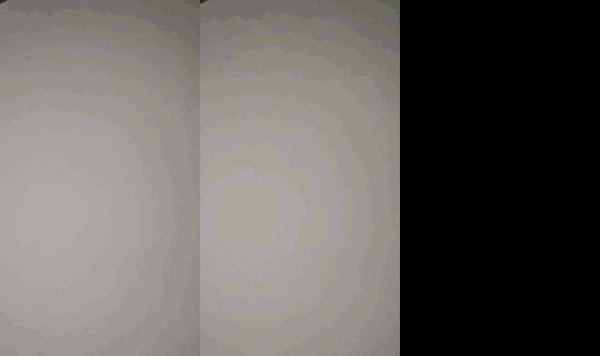

# shadowtrack

Finds and highlights cast shadows in images and videos.



*Left to right: original, shadow highlight overlay, binary shadow mask (`--threshold fixed`).*

## How it works

Everything is done in **CIE L\*a\*b\***. Lab separates lightness (*L*) from colour (*a*: green–red, *b*: blue–yellow). A cast shadow mostly lowers *L* and leaves the hue largely alone, so detecting shadows on *L* alone isn't thrown off by the colour of the surface. In OpenCV's 8-bit Lab, all three channels are stored as 0–255, with neutral grey at *a* = *b* = 128.

1. **Relative luminance.** Smooth *L* (Gaussian, σ = 1.5). Then estimate the lit background:
   - A 61×61 max filter (dilation) takes each pixel's brightest neighbour, which removes the dark shadow areas from the estimate.
   - A wide Gaussian blur (σ = 25) smooths the result.

   The ratio `r = L / bg` is about 1 on the lit wall and drops in shadow (in the demo clip: lit ≈ 0.96, shadow ≈ 0.39). Dividing by the local background, rather than using raw *L*, cancels out vignetting and uneven lighting.
2. **Threshold** `r` to get a binary mask:
   - `fixed` (shown above): soft ramp `(0.55 − r) / 0.15`, cut at 0.5, so the mask is `r < 0.475`. Blobs touching the top edge (the vignette band) are dropped. It's steady across frames and gives an empty mask when there are no shadows.
   - `adaptive` (default): Otsu per frame. It adapts to each frame's exposure, but Otsu always splits the image into two groups, so on a shadow-free frame it marks the vignette as shadow.
3. **Colour transform inside the shadow.** In shadow pixels, Lab is remapped as follows:

   | Channel | Mapping | Effect |
   |---|---|---|
   | *L* | `L' = 295 − 0.6·L` | Inverts lightness, so dark shadows turn near-white |
   | *a* | `a' = 128 − 1.5·(a − 128)` | Flips the colour to its opposite (green ↔ red) and makes it 1.5× stronger |
   | *b* | `b' = 128 − 2.0·(b − 128)` | Flips the colour to its opposite (blue ↔ yellow) and makes it 2× stronger |

   Flipping *a* and *b* around neutral grey (128) turns each colour into its opposite. The olive shadow (Lab ≈ 73, 122, 142) becomes a pale blue-white (≈ 251, 137, 100), and skin caught in the mask becomes cyan. The mask is feathered (Gaussian, σ = 1.2) and used as a blending weight, mixing the original and remapped Lab values: `lab·(1−m) + lab'·m`. The result is clipped to 0–255 and converted back to BGR.

## Usage

Requires [uv](https://docs.astral.sh/uv/) and Python 3.12.

```sh
uv sync
uv run shadow-highlight --threshold fixed dog.mp4   # -> dog_shadow.mp4, dog_mask.mp4
uv run shadow-highlight photo.jpg                   # -> photo_shadow.jpg, photo_mask.jpg (adaptive)
```

Outputs are written next to the input. Video outputs are always `.mp4`.

### As a library

```python
from shadowtrack import shadow, process

out, mask = shadow(bgr_frame, "fixed")      # one BGR uint8 frame
for out, mask in process(frames, "fixed"):  # any iterable of frames
    ...
```
